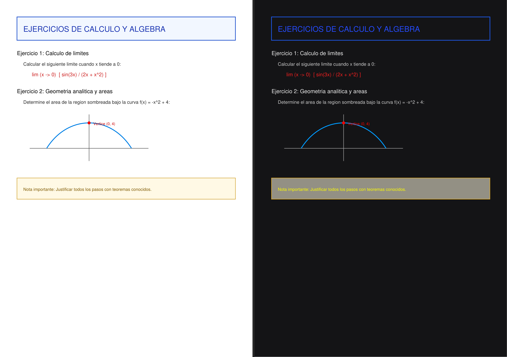

# Conversor de PDF a Modo Oscuro (Ultra-HD Vectorial)

Herramienta en Python para convertir documentos PDF a **Modo Oscuro** conservando la máxima legibilidad y nitidez:
- **Modo Vectorial Nativo:** 100% nítido, zoom infinito sin pixelación.
- **Texto seleccionable y copiable:** no aplana a imagen salvo en páginas escaneadas.
- **Preservación inteligente de color:** invierte fondos y textos mientras preserva y adapta figuras, gráficos matemáticos y diagramas.
- **Detección automática de escaneos:** fallback automático a 300 DPI de alta resolución para páginas escaneadas.
- **Acceso directo en Windows:** posibilidad de arrastrar y soltar cualquier PDF sobre el acceso directo o script `.bat`.



---

## 🚀 Requisitos e Instalación

1. Asegúrate de tener instalado **Python 3.10+**.
2. Clona este repositorio o descarga los archivos:
   ```bash
   git clone https://github.com/gonzalosancheznoriegacasado/pdf-dark-mode.git
   cd pdf-dark-mode
   ```
3. Crea un entorno virtual e instala las dependencias:
   ```bash
   python -m venv .venv
   .venv\Scripts\activate   # En Windows
   pip install -r requirements.txt
   ```

---

## 💻 Uso

### Opción 1: Arrastrar y Soltar (Windows)
1. Ejecuta el script `crear_acceso_directo.ps1` en PowerShell (creará un acceso directo en tu Escritorio):
   ```powershell
   powershell -ExecutionPolicy Bypass -File .\crear_acceso_directo.ps1
   ```
2. Arrastra cualquier archivo `.pdf` sobre el acceso directo o sobre `ARRASTRA_AQUI_TU_PDF.bat`.
3. Se generará automáticamente el archivo transformado con el sufijo `_dark.pdf` en la misma carpeta.

### Opción 2: Línea de comandos (CLI)
```bash
python invertir_pdf.py documento.pdf
```

#### Opciones avanzadas:
- `--pure-black`: Aplica un fondo negro puro (`#000000`) en lugar del tono grafito suave descansado por defecto.
- `--raster`: Fuerza la renderización matricial en lugar del modo vectorial.
- `--dpi <valor>`: Define la resolución DPI para páginas escaneadas (por defecto `300`).

---

## 📄 Licencia
Este proyecto está bajo la Licencia MIT.
